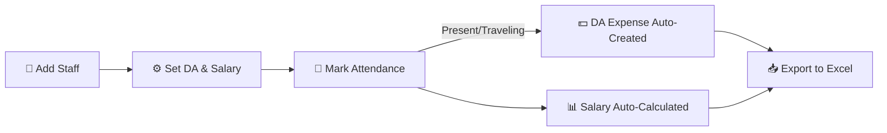

<div align="center">

# 💰 Expense Tracker

### The All-in-One Expense, Attendance & Salary Manager for Field Teams

[](https://spendone.lovable.app)
[](https://react.dev)
[](https://tanstack.com/start)
[](https://www.typescriptlang.org)
[](https://supabase.com)
[](https://tailwindcss.com)

**Track expenses, mark attendance, auto-calculate daily allowance & salary, manage customer ledgers — all in one place.**

[🌐 Live Demo](https://spendone.lovable.app) · [🐛 Report Bug](https://github.com) · [✨ Request Feature](https://github.com)

</div>

---

## 🎯 What is Expense Tracker?

**Expense Tracker** is a full-stack web app built for **shop owners, contractors, and field teams** who need to manage money and staff on the go. It replaces messy registers and spreadsheets with a fast, mobile-friendly app that works everywhere.

> 💡 **The big idea:** Mark a staff member **Present** → their **Daily Allowance (DA) is automatically added as an expense** → their **monthly salary is auto-calculated** based on working days. Zero manual math.

---

## ✨ Features

### 💸 Expense & Funding Management
- 📝 Log **expenses and funding** with custom categories
- 🗂️ Create unlimited **custom categories** (expense / funding)
- 📅 Filter transactions by **month, date range, or category**
- 🔍 Instant totals and running balance

### 🧑‍🏭 Staff & Attendance
- ✅ Mark **Present / 🚌 Traveling / ❌ Absent** per staff per day
- 💵 **Automatic DA expense** — when someone is marked present, an expense is created under **their name** with their DA amount
- ⚙️ **Per-user DA setting** — e.g. *Amrish = ₹300, Ravi = ₹250*
- 📆 Edit any past date — status changes automatically fix the linked expense

### 📊 Work Calendar & Salary Calculator
- 🗓️ Tap any date to toggle **working day / holiday**
- 🌴 Quick actions: *All Working*, *All Holiday*, *Sundays Off*
- 👤 **Individual staff calendar pages** showing their personal attendance heatmap
- 🧮 **Smart salary calculator:**
  - Monthly salary → prorated by working days: `(salary ÷ working days) × paid days`
  - Daily salary → `salary × paid days`
  - DA shown separately as *already paid*
- 🟢🚌🔴 Color-coded calendar dots for present / traveling / absent

### 📒 Khatabook (Customer Ledger)
- 👥 Add customers with phone numbers
- 💰 Record **Given / Taken** entries with notes
- 📈 Automatic **balance calculation** per customer
- 📲 **WhatsApp reminder** links for pending amounts

### 🗒️ Note Pad (Work Logs)
- 📅 Select a date and record **work start time & close time**
- ⏱️ Auto-calculates **session duration**
- 📝 Attach notes to any day

### 📥 Excel Export
- 📊 Download by **month**, **date range**, or **selected categories**
- 📑 Includes **category summaries**
- 📦 Or export **everything** in one click

### 🧹 Data Control
- 🗑️ Two-step **"Clear All Data"** for a fresh start
- 🔒 Every user's data is **fully private** (Row-Level Security)

---

## 🛠️ Tech Stack

| Layer | Technology |
| --- | --- |
| ⚛️ Frontend | **React 19** + **TypeScript** |
| 🚀 Framework | **TanStack Start v1** (SSR full-stack) |
| 🎨 Styling | **Tailwind CSS v4** + shadcn/ui |
| 🗄️ Backend | **Supabase** (Postgres + Auth + RLS) |
| 📦 State/Data | **TanStack Query** |
| 📄 Export | Excel (.xlsx) generation |

---

## 📱 Screens

```
🔐 Auth Landing  →  🏠 Dashboard  →  ➕ Add Expense  →  📅 Calendar
     │                   │               │                 │
  Features          Balance &       Categories &      Per-staff
  explained         totals          amounts           attendance
                                                    & salary calc
```

More routes: **Attendance** · **Month View** · **Categories** · **Funding** · **Khatabook** · **Len-Den** · **Note Pad** · **Export** · **Settings** · **Staff Profile**

---

## 🚀 Getting Started

### Prerequisites
- Node.js 18+ or Bun

### Installation

```sh
# 1. Clone the repository
git clone https://github.com/<your-username>/expense-tracker.git
cd expense-tracker

# 2. Install dependencies
npm install

# 3. Set up environment variables
# Copy .env.example to .env and fill in your Supabase credentials

# 4. Start the dev server
npm run dev
```

Open **http://localhost:8080** 🎉

---

## 🧭 How It Works



1. **Create an account** 🔐
2. **Add your staff** and set each person's DA & salary (monthly or daily)
3. **Mark attendance daily** — Present & Traveling auto-add DA as an expense
4. **Mark working days** on the calendar
5. **View auto-calculated salary** per staff, per month
6. **Export everything to Excel** anytime 📥

---

## 🔒 Security & Privacy

- 🛡️ **Row-Level Security** on every table — users only ever see their own data
- 🔑 Email/password authentication
- 🚫 No data sharing between accounts

---

## 🌟 Why Star This Project?

- ✅ Solves a **real problem** for small businesses & field teams
- ✅ Clean **TanStack Start + Supabase** architecture to learn from
- ✅ **Mobile-first** — designed for use on the phone, in the field
- ✅ Active development — new features landing regularly

**If this project helped you, please give it a ⭐ — it means a lot!**

---

## 🤝 Contributing

Contributions, issues and feature requests are welcome!

1. 🍴 Fork the project
2. 🌿 Create your feature branch (`git checkout -b feature/amazing`)
3. 💾 Commit your changes (`git commit -m 'Add amazing feature'`)
4. 📤 Push to the branch (`git push origin feature/amazing`)
5. 🔃 Open a Pull Request

---

## 📄 License

Distributed under the MIT License.

---

<div align="center">

### Made with ❤️ for shop owners and field teams

[⬆ Back to top](#-expense-tracker)

</div>
